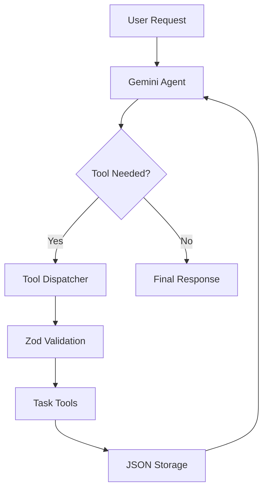

# TaskPilot — AI Agent Development with TypeScript

A hands-on AI agent engineering project built with TypeScript and Google's Gemini API.

TaskPilot demonstrates how to build, orchestrate, test, and evaluate an AI agent that performs real actions through custom tools.

The project progresses from basic LLM integration to a multi-tool agent with persistent storage, execution tracing, and automated evaluations.

## Overview

TaskPilot is a task-management AI agent that interprets natural-language requests and uses available tools to accomplish user goals.

Examples:

- "Show me my incomplete tasks."
- "Create a high-priority task to prepare for my interview."
- "Complete my Mandarin practice task."
- "Create a task and show me my updated task list."

Rather than simply generating suggestions, the agent can execute operations against a persistent task store.

## Tech Stack

- TypeScript
- Node.js
- Google Gemini API
- Google GenAI SDK
- Zod
- Vitest
- JSON file storage

## Architecture



### Core Components

| Component | Responsibility |
|---|---|
| `taskpilot.ts` | Agent orchestration and tool execution loop |
| `task-tools.ts` | Task creation, retrieval, and completion |
| `task-store.ts` | Persistent JSON storage |
| `agent-trace.ts` | Agent execution trace types |
| `agent-evaluation.ts` | Tool-selection and outcome evaluation |
| `live-evaluation.ts` | Single-scenario live evaluation |
| `live-evaluation-suite.ts` | Multi-scenario live evaluation |

## Available Tools

### get_tasks

Retrieves saved tasks and their completion status.

### create_task

Creates a task using a title and priority.

### complete_task

Marks an existing task as completed using its ID.

Each operation is executed by application-controlled TypeScript functions.

The AI model requests tool calls; it does not directly execute application code.

## Getting Started

### Prerequisites

- Node.js
- npm
- Gemini API key

### Installation

Clone the repository:

```bash
git clone https://github.com/lufhernaV2/AI-Agent-Crash-Course.git
cd AI-Agent-Crash-Course
```

Install dependencies:

```bash
npm install
```

Create a `.env` file:

```env
GEMINI_API_KEY=your_api_key_here
```

Never commit API keys or confidential information.

### Run the Agent

```bash
npx tsx src/day2/live-evaluation.ts
```

### Run Automated Tests

```bash
npx vitest run
```

### TypeScript Validation

```bash
npx tsc --noEmit
```

## Testing Strategy

TaskPilot uses deterministic tests to validate application behavior independently of the LLM.

The suite includes:

- Task creation and retrieval
- Task completion
- Invalid task handling
- Persistent storage
- Input validation
- Agent tool-selection evaluation
- Agent outcome evaluation

### Automated Test Results

| Test Category | Passing Tests |
|---|---:|
| Task functionality | 6 |
| Tool-selection evaluation | 3 |
| Outcome evaluation | 3 |
| **Total** | **12** |

All 12 tests passed during local development.

## Live Agent Evaluation

TaskPilot was evaluated using Gemini with isolated task data.

### Recorded Results

| Scenario | Result | Tool Calls | Duration |
|---|---|---|---:|
| Retrieve tasks | Passed | get_tasks | 5,730 ms |
| Create task | Passed | create_task | 4,404 ms |
| Complete task | Passed | get_tasks, complete_task | 7,217 ms |

**Observed goal-success rate: 100% (3/3 scenarios).**

These results represent a small development evaluation, not a claim of production reliability.

### Evaluation Method

Each scenario:

1. Initializes an isolated task database.
2. Sends a real request to Gemini.
3. Records the agent's tool calls.
4. Captures the resulting task state.
5. Checks the outcome against expected conditions.
6. Reports success or failure.

## Reliability and Safety

TaskPilot implements:

- Tool allowlisting
- Zod input validation
- Controlled errors for invalid operations
- Bounded agent execution
- Isolated evaluation environments
- Verification of application state
- Execution tracing

## Current Limitations

- Local JSON storage is intended for development.
- The agent is not designed for concurrent users.
- Evaluation coverage is limited to a small dataset.
- Final-response correctness is not fully evaluated.
- Live evaluations depend on external model availability.

## Future Improvements

- Larger golden evaluation datasets
- Repeated-run reliability measurements
- Additional negative and adversarial tests
- Structured final-response verification
- Improved API retries and rate-limit handling
- MCP integrations
- Database-backed task storage

## What I Learned

This project demonstrates several core AI agent engineering concepts:

1. LLMs make tool requests, while applications control execution.
2. Multi-step goals require an agent execution loop.
3. Tool functionality and agent decision-making must be tested separately.
4. Agent traces help explain execution behavior.
5. Evaluating final application state is more meaningful than checking tool selection alone.
6. Reliable agents require validation, error handling, and controlled execution.

## Author

Luis Hernandez

QA Engineering Leader | Test Automation | AI Quality Engineering

- GitHub: https://github.com/lufhernaV2
- Portfolio: https://heyitsluis.click

## Project Status

Completed learning proof of concept.

Future AI quality engineering work will explore requirements analysis, risk-based testing, and AI-assisted test planning.
