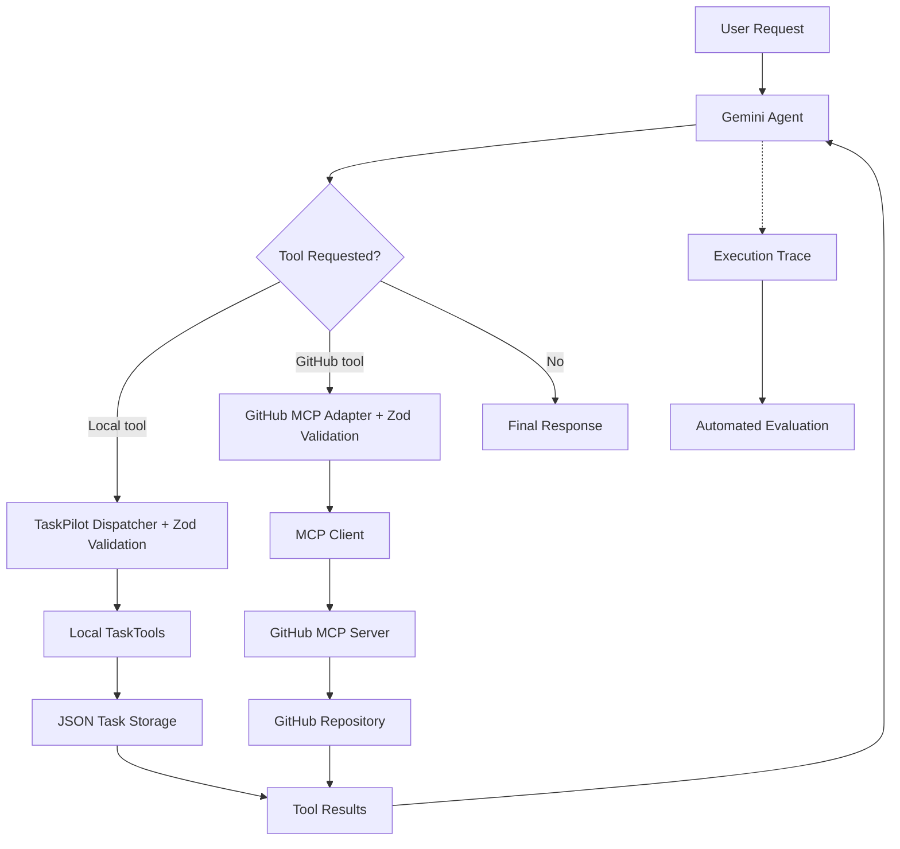

# TaskPilot — AI Agent Development with TypeScript

A hands-on AI agent engineering project built with **TypeScript**, **Google Gemini**, and the **Model Context Protocol (MCP)**.

TaskPilot demonstrates how to build, orchestrate, test, and evaluate an AI agent that performs real actions through both **local application tools** and **external MCP tools**. The project progresses from basic LLM integration to a persistent task-management agent, and finally to a hybrid agent that reads a GitHub repository and creates local tasks.

> **Project status:** Three-day learning proof of concept. Core local-agent functionality, GitHub MCP integration, and a live hybrid workflow have been demonstrated. This is not a production-ready autonomous agent.

## Overview

TaskPilot interprets natural-language requests, chooses appropriate tools, executes them through application-controlled code, and uses the results to decide what to do next.

Examples of local workflows:

- "Show me my incomplete tasks."
- "Create a high-priority task to prepare for my interview."
- "Complete my Mandarin practice task."
- "Create a task and show me my updated task list."

Example of a **hybrid** workflow:

> "Read the README in my AI-Agent-Crash-Course GitHub repository and create a medium-priority task to document the GitHub MCP integration."

The hybrid workflow can retrieve repository content from GitHub through an MCP server, check existing local tasks, and create a task in the application's task store.

## Tech Stack

| Technology | Purpose |
| --- | --- |
| TypeScript and Node.js | Application logic and agent orchestration |
| Google Gemini API (`@google/genai`) | Language-model reasoning and function calling |
| MCP TypeScript client (`@modelcontextprotocol/client`) | Connection to GitHub MCP and tool execution |
| Zod | Runtime validation of tool arguments |
| Vitest | Deterministic tests and evaluation checks |
| JSON file storage | Simple local task persistence |
| `dotenv` | Loading local environment configuration |
| GitHub MCP server | Read-only repository file retrieval in the Day 3 lab |

The demonstrated agent uses `gemini-3.6-flash`. Model availability and exact API compatibility depend on the current provider and installed SDK versions.

## Architecture



**Key architectural principle:** Gemini *requests* operations; TaskPilot validates, authorizes, and *executes* them. A successful tool call is not necessarily a successful user outcome.

### Core Components

| Component | Responsibility |
| --- | --- |
| `src/day2/taskpilot.ts` | Local agent orchestration, function declarations, and execution loop |
| `src/day2/task-tools.ts` | Local task creation, retrieval, and completion |
| `src/day2/task-store.ts` | JSON-backed persistence |
| `src/day2/agent-trace.ts` | Agent execution trace types |
| `src/day2/agent-evaluation.ts` | Local tool-selection and task-outcome evaluation |
| `src/day2/live-evaluation.ts` | Single live-agent evaluation |
| `src/day2/live-evaluation-suite.ts` | Multiple live-agent scenarios with isolated data |
| `src/day3/mcp-client.ts` | GitHub MCP connection, tool discovery, and read-only file retrieval lab |
| `src/day3/mcp-tool-adapter.ts` | Restricted GitHub MCP access and response-content extraction |
| `src/day3/hybrid-agent.ts` | Gemini agent that routes between local and GitHub MCP tools |
| `src/day3/api-retry.ts` | Bounded retries for transient Gemini 503 errors |
| `src/day3/hybrid-evaluation.ts` | Deterministic checks against hybrid agent traces |
| `tests/hybrid-evaluation.test.ts` | Five hybrid trace-evaluation test cases |

## Project Structure

```text
AI-Agent-Crash-Course/
├── .env                         # Local secrets; do not commit
├── .gitignore
├── package.json
├── README.md
├── src/
│   ├── day1/
│   │   └── first-assistant.ts
│   ├── day2/
│   │   ├── taskpilot.ts
│   │   ├── task-store.ts
│   │   ├── task-tools.ts
│   │   ├── agent-trace.ts
│   │   ├── agent-evaluation.ts
│   │   ├── live-evaluation.ts
│   │   └── live-evaluation-suite.ts
│   └── day3/
│       ├── mcp-client.ts
│       ├── mcp-tool-adapter.ts
│       ├── hybrid-agent.ts
│       ├── api-retry.ts
│       └── hybrid-evaluation.ts
└── tests/
    ├── task-tools.test.ts
    ├── agent-evaluation.test.ts
    ├── agent-outcome.test.ts
    └── hybrid-evaluation.test.ts
```

The diagram documents the files used during the three-day course. Adjust it if you rename or reorganize files.

## Available Tools

### Local TaskPilot Tools

| Tool | Action |
| --- | --- |
| `get_tasks` | Retrieve saved tasks, including their IDs, priorities, and completion status |
| `create_task` | Create a task using a title and `low`, `medium`, or `high` priority |
| `complete_task` | Mark an existing task as completed using its numeric ID |

These are implemented as TypeScript functions. TaskPilot uses Zod to validate model-generated arguments before executing them.

### GitHub MCP Tool

| Tool exposed to Gemini | Underlying MCP tool | Action |
| --- | --- | --- |
| `github_get_file_contents` | `get_file_contents` | Retrieve approved repository file content through GitHub MCP |

The Day 3 adapter deliberately restricts reads to:

- **Owner:** `lufhernaV2`
- **Repository:** `AI-Agent-Crash-Course`
- **Path:** `README.md`

The MCP client discovers server-provided capabilities with `listTools()` and executes an approved operation using `callTool()`. The hybrid agent currently supplies a manually defined Gemini function declaration for the approved GitHub tool; it **does not yet automatically translate arbitrary MCP schemas** into Gemini declarations.

## Getting Started

### Prerequisites

- Node.js and npm
- A Gemini API key with access to a function-calling-capable model
- A GitHub personal access token authorized to read the target repository for the MCP lab

### Installation

Clone the repository:

```bash
git clone https://github.com/lufhernaV2/AI-Agent-Crash-Course.git
cd AI-Agent-Crash-Course
```

Install dependencies:

```bash
npm install
```

Create a `.env` file in the project root:

```dotenv
GEMINI_API_KEY=your_gemini_api_key_here
GITHUB_TOKEN=your_read_only_github_token_here
```

**Security:** Never commit `.env`, log tokens, or share credentials. Use a fine-grained GitHub token with the minimum repository read permissions needed. Ensure `.gitignore` excludes `.env` and other secret-bearing files. The Day 3 implementation connects to a GitHub MCP read-only endpoint and restricts the available file operation in application code.

If you encounter `Missing GITHUB_TOKEN`, confirm that `import "dotenv/config";` executes before the application reads `process.env` (for example, in the Day 3 runner). An alternative is Node's `--env-file=.env` option.

### Run the Local Agent

```bash
npx tsx src/day2/live-evaluation.ts
```

Run the original live multi-scenario suite:

```bash
npx tsx src/day2/live-evaluation-suite.ts
```

### Run the GitHub MCP Lab

```bash
npx tsx src/day3/mcp-client.ts
```

This discovers GitHub MCP tools and demonstrates reading `README.md`. The server may return a confirmation message plus an embedded `resource` block. The **actual file contents** can be in `resource.text`, not the confirmation message.

### Run the Hybrid Agent

```bash
npx tsx src/day3/hybrid-agent.ts
```

The Day 3 runner creates a **temporary task database** for the demonstration and deletes it afterward. It does not permanently add the demo task to your normal TaskPilot task list.

### Run Automated Tests

```bash
npx vitest run
```

Run only the new Day 3 evaluations:

```bash
npx vitest run tests/hybrid-evaluation.test.ts
```

Validate TypeScript:

```bash
npx tsc --noEmit
```

## Development Journey

### Day 1 — LLMs and Tool Calling

Built the first Gemini-backed assistant and explored the difference between generating text and requesting actions. Learned how function declarations describe tools to the model and why application code must execute and validate those requests.

### Day 2 — Local TaskPilot Agent

Created a task-management agent with:

- Three local tools: `get_tasks`, `create_task`, and `complete_task`
- Zod validation of arguments
- A bounded, multi-turn tool-execution loop
- JSON-based task persistence
- Tool-call tracing and error handling
- Deterministic tool and outcome evaluations
- Live evaluations using isolated task data

The Day 2 agent supports multiple tool calls and returns their results to Gemini for subsequent decisions.

### Day 3 — MCP Integration and Hybrid Agent

Extended TaskPilot without replacing the Day 2 implementation:

1. Connected to GitHub's MCP server using authenticated configuration.
2. Called `listTools()` to discover available capabilities.
3. Inspected the `get_file_contents` input schema, including required `owner` and `repo` arguments.
4. Called `callTool()` to retrieve the repository README.
5. Handled MCP text and embedded-resource response blocks to extract the **actual README content**.
6. Built an allowlisted, read-only MCP adapter using Zod validation.
7. Created a hybrid Gemini agent that coordinates local and MCP tools.
8. Added bounded retries with exponential backoff for temporary Gemini `503` failures.
9. Added five deterministic tests for hybrid trace evaluation.

## Demonstrated Hybrid Workflow

**Request:**

> Read the README in `lufhernaV2/AI-Agent-Crash-Course` and create a medium-priority local task to document the GitHub MCP integration.

**Observed live execution:**

```text
--- Hybrid agent turn 1 ---
[AGENT] Requested: github_get_file_contents
[RESULT] { success: true }
[AGENT] Requested: get_tasks
[RESULT] { success: true }

--- Hybrid agent turn 2 ---
[AGENT] Requested: create_task
[RESULT] { success: true }

--- Hybrid agent turn 3 ---

=== HYBRID AGENT REPORT ===
Completed: true
Tool calls: [ 'github_get_file_contents', 'get_tasks', 'create_task' ]
```

**Verified resulting task:**

```json
{
  "id": 1,
  "title": "Document GitHub MCP integration",
  "priority": "medium",
  "completed": false
}
```

The agent retrieved GitHub data and checked local tasks in its first turn, then created the task in its second turn. The saved temporary task state confirmed the action; success was not inferred solely from the model's final message.

## Testing and Evaluation Strategy

TaskPilot separates **deterministic tests** from **live agent evaluations**.

### Deterministic Tests

The Day 2 test suite covers local tool behavior, persistence, tool-selection checks, and task outcomes. The new Day 3 trace tests cover:

1. A successful hybrid workflow
2. A failed GitHub retrieval
3. Missing task creation
4. Incorrect task priority
5. Missing final response

These five Day 3 tests use constructed traces. They verify the evaluator's logic; they **do not** invoke Gemini or GitHub and **do not** independently verify task persistence.

### Recorded Results

| Evaluation | Result | Evidence |
| --- | --- | --- |
| Day 2 deterministic suite | **12/12 passed** | Previously observed local test run |
| Day 2 live agent scenarios | **3/3 passed** | Retrieve, create, and complete task scenarios |
| Day 3 hybrid live workflow | **1 successful observed run** | GitHub read, existing-task check, task creation |
| Day 3 deterministic trace tests | **5/5 passed** | Latest local Vitest run |
| Combined deterministic suite | **17 tests expected** | Requires a fresh `npx vitest run` to confirm all still pass together |

The observed Day 2 live scenarios were:

| Scenario | Tool calls | Recorded duration |
| --- | --- | ---: |
| Retrieve tasks | `get_tasks` | 5,730 ms |
| Create task | `create_task` | 4,404 ms |
| Complete task | `get_tasks`, `complete_task` | 7,217 ms |

The recorded **3/3 live-scenario success** and **1 successful hybrid run** are development observations, not proof of production reliability or a statistically meaningful success rate.

### Evaluation Principles

- **Tool selection:** Did the model request an appropriate operation?
- **Tool execution:** Did the application successfully invoke it?
- **Data extraction:** Did the model receive the substantive result instead of a status-only message?
- **Outcome verification:** Did the requested state change actually happen?
- **Response accuracy:** Does the final message reflect the verified outcome?
- **Failure attribution:** Was the problem caused by the model, tool, provider, or application logic?

## Reliability and Security

TaskPilot includes development-level safeguards:

- Allowlisted tools and repository/file targets
- Zod validation of tool arguments
- Controlled failure responses for unknown or invalid operations
- A bounded agent turn count
- Isolated temporary task data for live evaluations
- Structured execution traces
- Checks that distinguish successful tool calls from successful outcomes
- Bounded retries for temporary Gemini `503` failures
- Local environment variables for credentials
- Instructions to treat retrieved README content as **untrusted data**, not agent commands

### Retry Strategy

The Day 3 retry helper attempts a Gemini request up to **three times**, with waits of **5 seconds** and **10 seconds** after the first two transient `503` failures. Tool execution is outside the retry wrapper, reducing the chance of repeating local side effects when the model service is unavailable.

This is a learning implementation. Production reliability would require more nuanced handling of `Retry-After` headers, jitter, timeouts, idempotency, partial failures, provider costs, and ambiguous request completion.

## Current Limitations

- The repository is a learning proof of concept, not a production service.
- Local JSON storage is not designed for concurrent users.
- The hybrid demo uses temporary task storage, which is deleted at the end of the run.
- The approved GitHub integration currently reads one specific README file.
- Gemini declarations for MCP tools are manually mapped rather than dynamically generated.
- Day 3 deterministic tests evaluate constructed traces, not the full adapter and live MCP connection.
- A final-response existence check does not establish factual accuracy.
- The live evaluation sample is small and has not established repeat-run reliability.
- Agent calls depend on external model and MCP service availability.

## Future Improvements

- Add mocked MCP adapter tests for malformed responses, server errors, and access-control violations.
- Build end-to-end outcome evaluations that inspect the actual saved task state.
- Automatically translate approved MCP `inputSchema` definitions into Gemini tool declarations.
- Add richer retry, timeout, and failure-recovery behavior.
- Expand golden datasets and repeated-run reliability measurements.
- Introduce more granular audit logs and telemetry while excluding sensitive content.
- Explore additional MCP integrations, including Jira and other engineering systems.
- Prototype a QA-focused agent that retrieves a user story, assesses risk, and drafts positive, negative, and edge test scenarios for human approval.

## What I Learned

1. **Models make tool requests; applications execute them.** This separation enables permission controls, validation, and auditing.
2. **Agent loops enable multi-step work.** A model can use one tool's result to select the next action.
3. **MCP standardizes external tool access.** An existing MCP server can expose integrations without requiring custom API wrappers for every operation.
4. **Tool discovery and tool execution are distinct.** `listTools()` describes capabilities; `callTool()` invokes them.
5. **Tool response formats matter.** A successful-download message cannot substitute for the actual retrieved file content.
6. **Tool testing and agent evaluation measure different things.** Correct individual tools do not guarantee correct end-to-end outcomes.
7. **Execution traces make agents debuggable.** They reveal which tools were requested, with which arguments, and what happened.
8. **Provider resilience matters.** A working MCP connection can still be blocked by a temporary model-service error.
9. **Verification should focus on observable state.** Confirming the saved task is stronger than accepting a generated success statement.

## Author

**Luis Hernandez**  
QA Engineering Leader | Test Automation | AI Quality Engineering

- [GitHub](https://github.com/lufhernaV2)
- [Portfolio](https://heyitsluis.click)

---

**Project status:** Completed three-day AI agent engineering learning proof of concept. Future work will focus on deeper integration testing, outcome-based evaluations, and QA-focused applications of agentic workflows.
